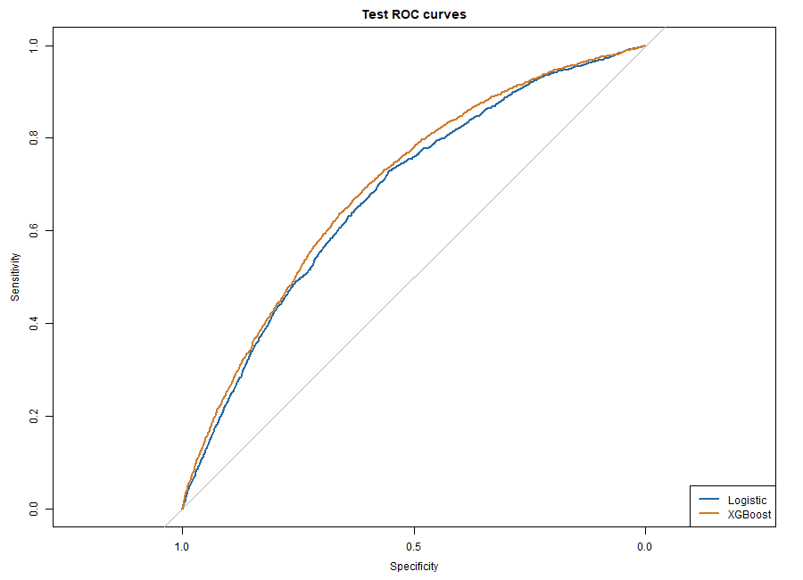
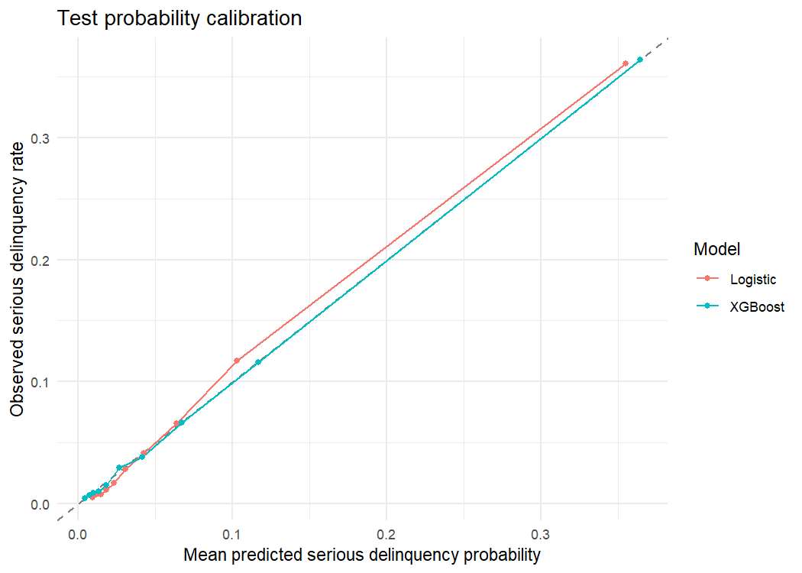
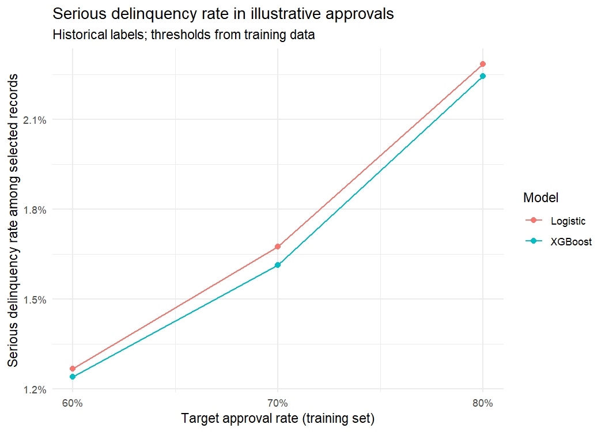
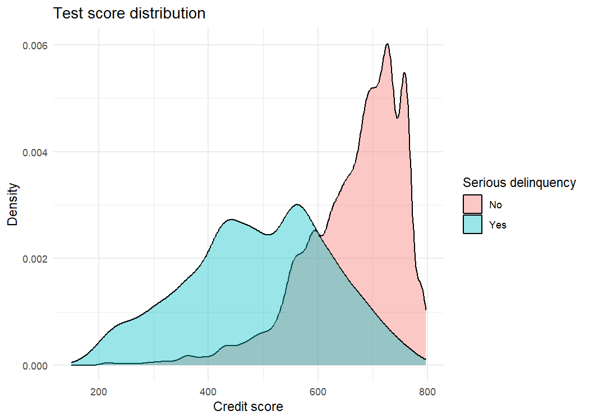

# Credit Risk Scorecard in R

This project uses the [Give Me Some Credit dataset](https://www.kaggle.com/competitions/GiveMeSomeCredit/data) to estimate two-year serious delinquency risk. A WOE-based logistic regression provides an interpretable scorecard; XGBoost is a fixed-settings benchmark. The analysis also asks whether better ranking translates into better probability estimates and lower observed serious delinquency rates among selected records.

## Data and method

`cs-training.csv` contains the observed outcome (`SeriousDlqin2yrs`, where 1 means serious delinquency within two years). The supplied `cs-test.csv` has no outcome labels, so it is used only for score-distribution comparison. Download both files from Kaggle; they are not redistributed in this repository. One record with `age <= 0` is removed from the labelled data. A stratified, seeded 70/30 split leaves **104,999 training** and **45,000 test** records; the external file has **101,503** records.

The training medians fill missing `MonthlyIncome` and `NumberOfDependents` values in all three datasets. The training set alone determines WOE bins, their IV, and the scorecard. The two column names containing hyphens are shortened to `Late30to59` and `Late60to89` internally so `scorecard_ply()` matches them to the fitted model. Variables are retained when **binned IV > 0.02**. The selected variables and IV are:

| Variable | Binned IV |
|---|---:|
| RevolvingUtilizationOfUnsecuredLines | 1.0470 |
| NumberOfTimes90DaysLate | 0.8407 |
| Late30to59 (30–59 day past dues) | 0.7193 |
| Late60to89 (60–89 day past dues) | 0.5776 |
| age | 0.2621 |
| NumberOfOpenCreditLinesAndLoans | 0.0789 |
| DebtRatio | 0.0692 |
| MonthlyIncome | 0.0674 |
| NumberRealEstateLoansOrLines | 0.0576 |
| NumberOfDependents | 0.0351 |

Revolving utilization and past-due counts describe credit use and delinquency history that can inform a lending decision. Their high IV warrants review, but is not itself evidence of target leakage. The supplied files do not include observation timestamps, so the historical timing of individual records cannot be independently checked.

On the training set, `Late60to89` has 99,763 records at 0 (5.14% serious delinquency), 3,951 at 1 (30.83%), 1,093 at 2–89 (51.78%), and 4/188 at 96/98 (75.0%/55.85%). The default 5% minimum bin share merges the whole variable into one bin because only 4.99% have a nonzero value. Using a 1% minimum **for this variable alone** gives 0, 1, and 2+ bins with IV 0.5776. The 2+ bin includes 96/98; its 52.45% serious delinquency rate is close to the 51.78% rate for ordinary 2–89 values. All 192 training records with 96/98 have the same value in each of the three past-due columns, suggesting an unusual code, but its meaning is undocumented. No values are deleted or replaced.

Extreme revolving utilization above 100 occurs in 168 training records and remains in a 15,922-record high-utilization bin. For `DebtRatio > 10`, 18,819 of 20,254 training records have missing income. The highest DebtRatio bin has a lower observed serious delinquency rate than the preceding bin; it should not be read as evidence that more debt is safer. No outlier treatment was chosen from test results.

Logistic regression and XGBoost use the same selected WOE variables. XGBoost has fixed parameters and 100 rounds, so this comparison concerns models on the **same binned representation**, not XGBoost on raw features. The current script does not use the test set for fitting, tuning, or early stopping. However, earlier IV-rule changes were considered after viewing test AUC, so these test results are exploratory rather than a fresh independent validation. Lower Brier score means more accurate probability predictions.

The logistic scorecard uses `scorecard::scorecard()` and `scorecard_ply()` with **600 points at event:non-event odds of 1:15** and **PDO = 60**. In terms of predicted serious delinquency probability `p`, the scaling is `600 - 60/log(2) * log((p/(1-p))/(1/15))`. Higher serious delinquency risk gives a lower score. After fixing the two column names, calculated scores differ from this continuous formula by at most 3.3 points on training records because bin points are rounded. The WOE coefficients are positive except for a small, statistically uncertain negative coefficient on open credit lines; its score contribution should not be interpreted as a reliable risk effect. DebtRatio and real-estate loan bins are not monotonic in observed risk.

## Results

| Model | Test AUC | KS | Brier score | AUC 95% CI (DeLong) |
|---|---:|---:|---:|---:|
| Logistic regression | 0.8615 | 0.5690 | 0.05044 | 0.8546–0.8685 |
| XGBoost | 0.8664 | 0.5798 | 0.04924 | 0.8596–0.8732 |

XGBoost's AUC advantage is **0.0049** (paired DeLong 95% CI **0.0033–0.0064**, p = **9.73 × 10⁻¹⁰**): statistically detectable in this large sample, but small in practice. XGBoost also has a slightly lower Brier score. The [calibration plot](Outputs/Calibration.png) shows both models close to observed rates across training-defined probability groups. AUC measures ranking, not probability accuracy, so the Brier score and calibration plot address a separate question. The interval and p-value do not account for earlier decisions influenced by this test set.





For an illustrative approval exercise, each cutoff is the 60th, 70th, or 80th percentile of **training** predictions. Test records below the cutoff are selected as hypothetical approvals. This uses historical outcome labels to compare risk ranking; it does not measure the effect of a real lending policy.

| Model | Target approval | Selected share of test set | Serious delinquency rate among selected |
|---|---:|---:|---:|
| Logistic regression | 60% | 59.93% | 1.27% |
| XGBoost | 60% | 59.81% | 1.24% |
| Logistic regression | 70% | 69.90% | 1.68% |
| XGBoost | 70% | 69.94% | 1.61% |
| Logistic regression | 80% | 79.87% | 2.28% |
| XGBoost | 80% | 79.95% | 2.24% |

The XGBoost groups have slightly lower observed serious delinquency rates at all three targets. Selected shares differ a little because the cutoffs come from training data. This is a historical-sample risk ranking exercise, not an estimate of a real bank approval policy's effect. The labelled test set's overall serious delinquency rate is **6.68%**.



Score PSI uses training-score decile boundaries for both comparisons: **0.00027** for training versus the random holdout, and **0.00026** for training versus the supplied unlabeled file. These small values are only distribution checks. Neither comparison is a time-based stability test, and outcomes are unavailable for the external file.



## Reproduce

Download `cs-training.csv` and `cs-test.csv` from Kaggle's [Give Me Some Credit dataset](https://www.kaggle.com/c/GiveMeSomeCredit/data) and place them in the project root. From there, install `scorecard`, `ggplot2`, `xgboost`, and `pROC`, then run:

```r
source("Credit_Risk_Scorecard.R")
```

The script prints the selected IV values, sample sizes, model metrics, DeLong intervals and test, PSI, and approval table. It writes four figures to `Outputs/`. Results above were generated with R 4.4.1, `scorecard` 0.4.6, `ggplot2` 4.0.3, `xgboost` 3.2.1.1, and `pROC` 1.19.0.1.
